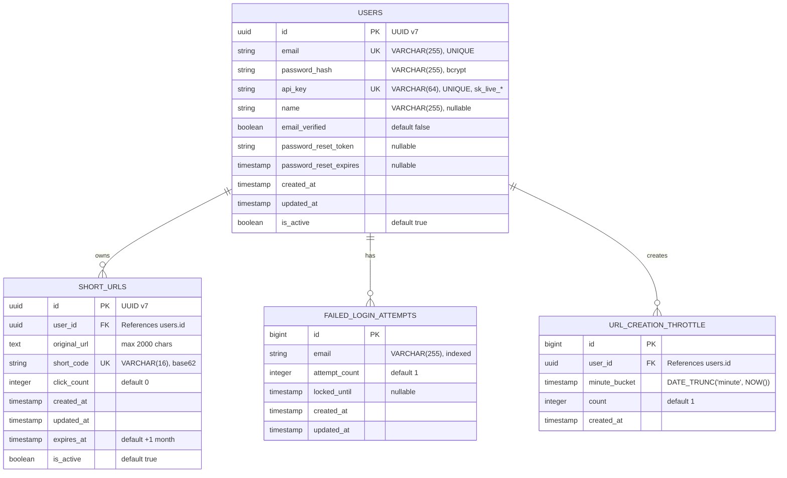
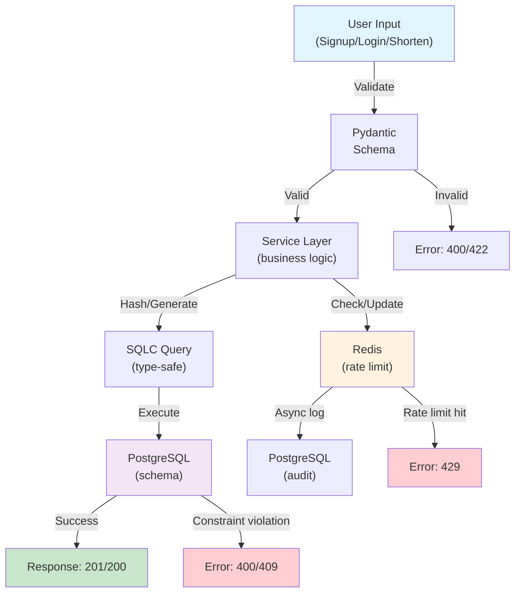

# Phase 1: Foundation Specification

**Date:** 2026-10-12  
**Last Update:** 2026-10-12  
**Version:** 1.0  
**Based on:** `/docs/project/MACRO.md` (URL Shortener REST API)  
**Priority:** HIGH  
**Effort:** 3-4 days  
**Risk:** LOW (well-scoped, single concern)

---

## Changelog v1.0

- Initial specification

---

## Objective (Why)

**Business Problem:** URL Shortener service needs foundational data models and database schema before any API endpoints or business logic can be implemented.

**Technical Solution:** Define User and ShortUrl models with PostgreSQL 18 schema (UUID v7 primary keys), SQLC type-safe query generation for CRUD operations, and support for authentication (signup, login, password reset) and rate limiting infrastructure (login lockout, URL creation throttle).

**Link to MACRO:** This phase realizes the foundational architectural decisions in MACRO.md:
- User authentication via email + bcrypt password hashing + unique API keys
- Short URL generation via base62(user_id[:5] + random digits)
- Expiry enforcement (1 month TTL, soft delete)
- Rate limiting infrastructure (Redis + PostgreSQL audit)

---

## Functional Description (What)

### User Model

**Purpose:** Store user credentials and authentication metadata.

**Observable Behavior:**
- New users register with email + password
- System generates unique API key (plaintext, `sk_live_...` format)
- Password is hashed with bcrypt (never stored plaintext)
- Users can reset password via magic-link token (15 min TTL)
- Users can view their API key (returned on signup, hidden on login)

### ShortUrl Model

**Purpose:** Store shortened URL mappings with user ownership and click tracking.

**Observable Behavior:**
- Users create short URLs from long URLs
- System generates unique short_code via base62(user_id[:5] + random 6-10 digits)
- URLs optionally support custom short_code (validated in Phase 2)
- Each URL expires after 1 month (soft delete with is_active flag)
- Clicking short URL increments click_count, does not delete or expire the URL
- Users can only delete/update their own URLs (authorization)

### Rate Limiting Infrastructure

**Purpose:** Prevent brute-force login attacks and URL creation spam.

**Observable Behavior:**
- Failed login attempts tracked per email (Redis counter + PostgreSQL audit)
- After 3 failed attempts → 5 minute lockout (per email)
- URL creation limited to 1 per minute per user (Redis counter + PostgreSQL audit)
- Both tracked in real-time via Redis, persisted for analytics in PostgreSQL

---

## Technical Flow

### Signup Flow
```
User Input: POST /auth/signup
  ├─ Validate: email (unique), password (8+ chars, mixed case)
  ├─ Hash password: bcrypt(password, cost=12)
  ├─ Generate API key: sk_live_ + 32 random hex chars
  ├─ Create user: INSERT INTO users (email, password_hash, api_key, ...)
  ├─ Initialize rate limit: Redis SET rate_limit:login:{email} = 0 (TTL: 5 min auto-reset)
  └─ Response: 201 Created, user ID + API key

Business Rules:
- Email must be unique (DB constraint: UNIQUE(email))
- API key must be unique (DB constraint: UNIQUE(api_key))
- Password hash begins with $2b$ (bcrypt marker)
```

### Login Flow
```
User Input: POST /auth/login
  ├─ Check rate limit: GET rate_limit:login:{email} from Redis
  ├─ If locked (TTL not expired): return 429 Too Many Requests
  ├─ Query user: SELECT FROM users WHERE email = $1
  ├─ Validate: password vs. password_hash (bcrypt.checkpw)
  ├─ If success: reset counter (DELETE or EXPIRE), return 200 with api_key
  ├─ If failure: increment Redis counter, INSERT INTO failed_login_attempts, return 401

Business Rules:
- Max 3 failed attempts per email
- Lockout duration: 5 minutes (Redis TTL)
- On success: counter cleared automatically
- Audit log kept for analytics (failed_login_attempts table)
```

### ShortUrl Creation Flow
```
User Input: POST /shorten (with X-API-Key header)
  ├─ Authenticate: SELECT FROM users WHERE api_key = $1
  ├─ Check rate limit: GET rate_limit:shorten:{user_id}:{minute} from Redis
  ├─ If >= 1: return 429 Too Many Requests
  ├─ Validate: long_url (RFC 3986 URL, max 2000 chars)
  ├─ Generate short_code: base62(user_id[:5] + random_6_10_digits)
  ├─ Check uniqueness: SELECT FROM short_urls WHERE short_code = $1
  ├─ If exists: retry (max 3 attempts), then fail with 409 Conflict
  ├─ Create URL: INSERT INTO short_urls (user_id, original_url, short_code, expires_at)
  ├─ Increment throttle: INCR rate_limit:shorten:{user_id}:{minute} (TTL: 60 sec)
  ├─ Audit: INSERT INTO url_creation_throttle (user_id, minute_bucket, count)
  └─ Response: 201 Created, short_code + short_url

Business Rules:
- short_code algorithm: user_id[:5] + random (ensures user traceability)
- Collision handling: retry with new random digits (max 3 attempts)
- Rate limit: 1 per minute per user (checked via Redis, audited to DB)
- Expiry: NOW() + 1 month (default, stored as expires_at)
```

### Redirect Flow
```
User Input: GET /{short_code}
  ├─ Query: SELECT FROM short_urls WHERE short_code = $1 AND is_active = true AND expires_at > NOW()
  ├─ If not found: return 404 Not Found
  ├─ If expired: return 410 Gone
  ├─ Increment click: UPDATE short_urls SET click_count = click_count + 1 WHERE id = $1
  ├─ Track (async): INSERT INTO analytics_daily (date, short_url_id, click_count) — Phase 3
  └─ Response: 302 Found, Location: {original_url}

Business Rules:
- Return 302 (not 301) to track every redirect
- Only active, non-expired URLs redirect
- Click count incremented atomically
```

---

## Acceptance Criteria

### Feature: User Registration
```gherkin
Scenario: Signup with valid credentials
  Given no user with email "test@example.com"
  When I POST /auth/signup with email="test@example.com", password="SecurePassword123"
  Then response status is 201 Created
  And response contains user.id (UUID v7)
  And response contains api_key starting with "sk_live_"
  And password_hash in DB starts with "$2b$" (bcrypt)
  And password_hash != "SecurePassword123" (not plaintext)

Scenario: Signup rejects duplicate email
  Given user "test@example.com" already exists
  When I POST /auth/signup with email="test@example.com", password="SecurePassword123"
  Then response status is 400 Bad Request
  And error message contains "Email already exists"
  And only 1 user with that email in DB

Scenario: Signup rejects weak password
  Given no user with email "test@example.com"
  When I POST /auth/signup with password="weak" (< 8 chars)
  Then response status is 422 Unprocessable Entity
  And error message contains "Password must be at least 8 characters"
  And no user created

Scenario: Signup generates unique API key
  Given 2 users signup successfully
  When I query DB for both api_keys
  Then api_key_1 != api_key_2
  And both start with "sk_live_"
  And both are 40 characters long
```

### Feature: User Login
```gherkin
Scenario: Login with correct credentials
  Given user with email="test@example.com", password="SecurePassword123"
  When I POST /auth/login with email="test@example.com", password="SecurePassword123"
  Then response status is 200 OK
  And response contains api_key
  And rate_limit:login:{email} counter is reset to 0

Scenario: Login rejects invalid password
  Given user with email="test@example.com", password="SecurePassword123"
  When I POST /auth/login with email="test@example.com", password="WrongPassword"
  Then response status is 401 Unauthorized
  And rate_limit:login:{email} counter incremented (now = 1)
  And failed_login_attempts row inserted with attempt_count=1

Scenario: Login locks after 3 failed attempts
  Given user with email="test@example.com"
  When I POST /auth/login 3 times with wrong password
  Then 4th attempt returns 429 Too Many Requests
  And response header Retry-After: 300 (5 minutes)
  And rate_limit:login:{email} locked_until > NOW()
  And failed_login_attempts shows attempt_count=3, locked_until set

Scenario: Login unlocks after 5 minutes
  Given user locked (attempt_count=3, locked_until=NOW()+5min)
  When I wait 5 minutes 1 second
  Then next login attempt returns 401 (not 429)
  And rate_limit:login:{email} counter reset
```

### Feature: Password Reset
```gherkin
Scenario: Request password reset
  Given user with email="test@example.com"
  When I POST /auth/password-reset-request with email="test@example.com"
  Then response status is 200 OK
  And response message is "Check your email for reset link"
  And password_reset_token generated (32 hex chars)
  And password_reset_expires = NOW() + 15 minutes
  And (email sends magic-link — out of scope)

Scenario: Reset password with valid token
  Given user with valid password_reset_token, expires_at = NOW() + 10 min
  When I POST /auth/password-reset with token=XXXXX, new_password="NewPassword456"
  Then response status is 200 OK
  And password_hash updated with bcrypt("NewPassword456")
  And password_reset_token cleared (set to NULL)
  And old password no longer works

Scenario: Reset rejects expired token
  Given user with password_reset_token, expires_at = NOW() - 1 minute (expired)
  When I POST /auth/password-reset with token=XXXXX, new_password="NewPassword456"
  Then response status is 400 Bad Request
  And error message is "Token expired"
  And password unchanged
```

### Feature: ShortUrl Creation
```gherkin
Scenario: Create short URL with valid long URL
  Given authenticated user with api_key="sk_live_..."
  When I POST /shorten with long_url="https://example.com/very/long/path?foo=bar"
  Then response status is 201 Created
  And response contains short_code (11-16 chars, alphanumeric)
  And short_code starts with user_id[:5]
  And short_code unique in DB
  And original_url stored as-is in DB
  And expires_at = NOW() + 1 month

Scenario: Shorten rejects invalid long URL
  Given authenticated user
  When I POST /shorten with long_url="not a url"
  Then response status is 422 Unprocessable Entity
  And error message contains "Invalid URL format"
  And no ShortUrl created

Scenario: Shorten rejects oversized URL (>2000 chars)
  Given authenticated user
  When I POST /shorten with long_url=X*2001 (2001 chars)
  Then response status is 422 Unprocessable Entity
  And error message contains "URL too long"

Scenario: Rate limit: 1 URL per minute per user
  Given authenticated user
  When I POST /shorten twice in the same minute
  Then 1st response: 201 Created
  And 2nd response: 429 Too Many Requests
  And response header Retry-After: 60
  And rate_limit:shorten:{user_id}:{minute} = 1 (no increment beyond 1)

Scenario: Rate limit resets per minute
  Given user hit rate limit at 12:00:59
  When I POST /shorten at 12:01:00 (next minute)
  Then response: 201 Created (limit reset)
  And rate_limit:shorten:{user_id}:12:01 = 1 (new counter)
```

### Feature: URL Redirect
```gherkin
Scenario: Redirect to original URL
  Given short_code="abc123" → original_url="https://example.com/long"
  When I GET /abc123
  Then response status is 302 Found
  And Location header = "https://example.com/long"
  And click_count incremented (now = 1)

Scenario: Redirect not found
  Given short_code="invalid" does not exist
  When I GET /invalid
  Then response status is 404 Not Found

Scenario: Redirect to expired URL
  Given short_code="abc123", expires_at = NOW() - 1 day
  When I GET /abc123
  Then response status is 410 Gone

Scenario: Redirect to soft-deleted URL
  Given short_code="abc123", is_active = false
  When I GET /abc123
  Then response status is 404 Not Found

Scenario: Click count increments on each redirect
  Given short_code="abc123", click_count=0
  When I GET /abc123 (3 times)
  Then final click_count = 3
```

### Feature: Database Schema & Constraints
```gherkin
Scenario: UUID v7 primary keys created
  When I create user or short_url
  Then id is UUID v7 format
  And id is non-null, unique, sequential by timestamp

Scenario: Email uniqueness constraint
  Given user_1.email = "test@example.com"
  When I try to insert user_2 with same email
  Then DB raises UNIQUE constraint violation
  And user_2 not created

Scenario: API key uniqueness constraint
  Given user_1.api_key = "sk_live_abc123"
  When I try to insert user_2 with same api_key
  Then DB raises UNIQUE constraint violation

Scenario: ShortUrl uniqueness constraint
  Given short_url_1.short_code = "abc123"
  When I try to insert short_url_2 with same short_code
  Then DB raises UNIQUE constraint violation

Scenario: FK constraint: ShortUrl.user_id → User.id
  Given user.id = "uuid-123"
  When I insert short_url with user_id = "uuid-invalid"
  Then DB raises FK constraint violation

Scenario: Cascading delete: User deletion cascades to ShortUrls
  Given user has 5 short_urls
  When I DELETE user
  Then all 5 short_urls deleted (or is_active = false)
```

---

## Assumptions

| Assumption | Validation Plan |
|-----------|-----------------|
| PostgreSQL 18 with UUID v7 extension available | Verify in docker-compose.yml (postgres:18.4) |
| bcrypt password hashing adequate security | Confirm cost=12 balances security + performance (Phase 1.5 load test) |
| 1 URL/minute rate limit is sufficient UX | Monitor Phase 2 user feedback; adjust in Phase 3 if needed |
| Redis available for real-time counters | Verify docker-compose redis:8.10.0 starts; fallback to DB only in Phase 1.5 if needed |
| SQLC code generation tooling installed | Confirm `sqlc generate` works in CI/CD; add to setup docs |
| Email service out of scope (mocked in tests) | Implement in Phase 1.5 auth endpoints; Phase 1 is DB-only |
| Base62 collision rare enough for retries | Test: generate 1M codes, check collisions; if >0.1%, use UUID short_code instead |

---

## Technical Considerations

### Database
- **Engine:** PostgreSQL 18 (supports native UUID v7)
- **Indices:** Optimized for queries on email, api_key, short_code, user_id, is_active
- **Constraints:** UNIQUE (email, api_key, short_code), FK (user_id), NOT NULL
- **Soft Delete:** is_active BOOLEAN, expired URLs kept for analytics (not deleted)
- **Transaction Isolation:** READ COMMITTED adequate (no high-concurrency writes)

### SQLC Code Generation
- **Location:** `sql/queries/users.sql`, `sql/queries/shorturl.sql`
- **Output:** `app/db/sqlc/users.py`, `app/db/sqlc/shorturl.py`
- **Type Safety:** All queries generated with type hints (Pydantic models or dataclasses)
- **No ORM:** Raw SQL via SQLC, minimal framework overhead

### Rate Limiting (Hybrid)
- **Real-time:** Redis counters (fast, in-memory)
  - `rate_limit:login:{email}` → attempt count (TTL: 5 min auto-reset)
  - `rate_limit:shorten:{user_id}:{minute}` → URL count (TTL: 60 sec)
- **Audit Trail:** PostgreSQL tables (durable, queryable)
  - `failed_login_attempts` → email, attempt_count, locked_until, created_at
  - `url_creation_throttle` → user_id, minute_bucket, count, created_at

### Security
- **Password Hashing:** bcrypt with cost=12 (balance of security/speed)
- **API Key Format:** Plaintext in Phase 1 (upgrade to hashed in Phase 3)
- **Password Reset:** Magic-link token (32-char random hex, 15 min TTL, single-use)
- **Authorization:** All URL operations scoped to authenticated user_id
- **Input Validation:** Pydantic at API boundary, DB constraints as safety net

### Observability
- **Logging:** Structured JSON logs from FastAPI (trace_id, user_id, duration_ms)
- **Metrics:** Prometheus metrics for signup/login/shorten operations (Phase 5)
- **Traces:** OTEL spans for user CRUD, auth operations (Phase 5)

---

## Solution Design

### ER Diagram (Mermaid)



### Data Flow Diagram



---

## Definition of Done

### Database
- [ ] PostgreSQL 18 schema created with 4 tables (users, short_urls, failed_login_attempts, url_creation_throttle)
- [ ] All indices created (email, api_key, short_code, user_id, is_active, created_at)
- [ ] All constraints enforced (UNIQUE, FK, NOT NULL, CHECK)
- [ ] Migration script tested (can be created/dropped idempotently)

### SQLC Code Generation
- [ ] All queries in `sql/queries/*.sql` pass `sqlc compile`
- [ ] Generated Python code in `app/db/sqlc/*.py` is type-safe (type hints present)
- [ ] All CRUD operations working (create, read, update, delete, list)
- [ ] Auth queries (get by email, token, api_key) working
- [ ] Rate limiting queries (insert, get count, clear) working

### Testing
- [ ] E2E tests: User signup, login, password reset (full flows)
- [ ] E2E tests: ShortUrl creation, redirect, soft delete (full flows)
- [ ] Integration tests: Database constraints validated (uniqueness, FK)
- [ ] Unit tests: Password hashing, API key generation, short_code base62 algorithm
- [ ] Unit tests: Boundary conditions (email validation, URL length, password TTL)
- [ ] Coverage > 80% of critical rules (auth, CRUD, constraints)
- [ ] All tests pass locally and in CI/CD

### Documentation
- [ ] README.md updated with Phase 1 completion
- [ ] SQLC schema documented (table descriptions, indices, constraints)
- [ ] Auth flow documented (signup, login, password reset)
- [ ] Rate limiting strategy documented (Redis + DB audit)
- [ ] Deployment instructions clear (schema migration, SQLC generation)

### Code Quality
- [ ] Linting passes (ruff check)
- [ ] Type checking passes (mypy strict)
- [ ] No hardcoded secrets or passwords
- [ ] Error messages are user-facing (not stack traces)

---

## Verification Checklist

- [ ] Requirements validated with stakeholder (Marcel)
- [ ] Impact on existing contracts mapped (none; new project)
- [ ] Dependencies clear (PostgreSQL 18, Redis, bcrypt, SQLC)
- [ ] No [ASSUMPTION] left unvalidated
- [ ] Design reviewed and approved (all 4 sections)
- [ ] Testing strategy aligned with Henriquefy principles (Photo/Film, risk-based)
- [ ] Rollback strategy clear (DB schema reversible via migration)

---

**Next Steps:**
1. User reviews this spec
2. Invoke writing-plans skill for implementation plan
3. Implement Phase 1 tasks sequentially

